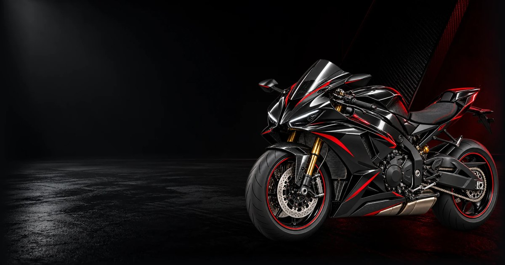

<div align="center">

# KASKADYOR

**Moto ekipirovka va ehtiyot qismlar do‘koni uchun bir sahifali brend sayt**

[kaskadyor.uz](https://kaskadyor.uz) · [Telegram guruh](https://t.me/kaskakadyor) · [Instagram](https://www.instagram.com/_kaskadyor/)




</div>

**Kaskadyor** — Toshkentdagi (Sabzazor ko‘chasi) mototsikl ekipirovkasi va ehtiyot qismlar do‘koni, O‘zbekiston bo‘ylab yetkazib beradi. Bu repozitoriy do‘konning brend sayti. Saytning vazifasi ikkita: do‘konni jiddiy motosport brendi sifatida ko‘rsatish va tashrif buyuruvchini do‘konning haqiqiy savdo kanallariga (Telegram guruh va Instagram) yo‘naltirish. Katalog va buyurtma Telegramda, saytda emas.

Sayt to‘liq statik: build vaqtida prerender qilinadi va nginx tomonidan Cloudflare orqasida beriladi. Backend, ma’lumotlar bazasi va port yo‘q.

## Mundarija

- [Imkoniyatlar](#imkoniyatlar)
- [Ishlab chiqish rejimi](#ishlab-chiqish-rejimi-sayt-ishlab-chiqilmoqda)
- [Texnologiyalar](#texnologiyalar)
- [Ishga tushirish](#ishga-tushirish)
- [Build qanday ishlaydi](#build-qanday-ishlaydi)
- [Loyiha tuzilmasi](#loyiha-tuzilmasi)
- [Rasmlar va assetlar](#rasmlar-va-assetlar)
- [Deploy (server)](#deploy-server)
- [Kontent qoidalari](#kontent-qoidalari-saytda-toqib-chiqarilmaydigan-faktlar)
- [Hujjatlar](#hujjatlar)
- [Dasturchi](#dasturchi)

## Imkoniyatlar

- **Bitta hero bo‘lim.** Butun sayt bitta ekran: "Biz haqimizda", mahsulotlar to‘ri, sharhlar, FAQ yoki footer yo‘q. Kadrning markazida mototsikl turadi.
- **Kinematografik intro.** Kirish animatsiyasi sof CSS’da (`.reveal`, `.headline-text`, `.intro`). U hydration’dan oldin ishlaydi, kiritishni bloklamaydi va `prefers-reduced-motion` yoqilganda harakatsiz kompozitsiyaga aylanadi. Bir sessiya ichida qayta kirilganda parda o‘tkazib yuboriladi.
- **"Uzatma indikatori" (gear selector).** Navigatsiyaning o‘zi mototsikl uzatmasiga o‘xshaydi: **N** mototsiklni ko‘rsatadi, **1** motoshlem, **2** qo‘lqop, **3** ekipirovka. Uzatma tanlanganda mototsikl xiralashadi va fokusdan chiqadi, ekipirovka esa oldinga chiqadi. Selektor `radiogroup` sifatida yozilgan: strelkalar, `Home`/`End` bilan boshqariladi va o‘zgarishni live region orqali e’lon qiladi.
- **Faqat tasdiqlangan kanallar.** Har bir tugma haqiqiy manzilga olib boradi (Telegram guruh yoki Instagram). To‘qib chiqarilgan katalog havolalari yoki bo‘sh anchor’lar yo‘q.
- **Prerender.** H1, matn, havolalar va rasmlar birinchi HTML javobning o‘zida keladi. Sayt JavaScript’siz ham ishlaydi, LCP va SEO uchun ham foydali.
- **Telefon birinchi.** Tashrif buyuruvchilarning ko‘pi Instagram va Telegram’dan telefonda keladi. Layout 360 px’dan katta ekranlargacha moslashadi, rasmlar `srcset` bilan beriladi.
- **Accessibility.** WCAG AA kontrast, to‘liq klaviatura boshqaruvi, ko‘rinadigan fokus, mobil menyuda focus trap va `Esc`. Animatsiya ishlamasa ham kontentdan foydalanish mumkin.
- **Xavfsizlik.** Qat’iy CSP (inline skript SHA-256 hash bilan ruxsat etilgan), HSTS, `X-Frame-Options: DENY`, `Permissions-Policy`, `Referrer-Policy`.

## Ishlab chiqish rejimi ("sayt ishlab chiqilmoqda")

2026-10-12 dan sayt ishlab chiqish rejimida. Rejim `src/lib/pages.ts` dagi bitta `UNDER_DEVELOPMENT` o‘zgaruvchisi bilan almashtiriladi.

| Yo‘l | `UNDER_DEVELOPMENT = true` (hozir) | `UNDER_DEVELOPMENT = false` |
|---|---|---|
| `/` | Kutish sahifasi (`UnderDevelopment.tsx`): "SAYT / ISHLAB / CHIQILMOQDA." yozuvi va dasturchi kontaktlari | To‘liq hero |
| `/demo` | To‘liq hero, wordmark yonida `/` ga qaytaradigan DEMO belgisi bor. `noindex` (meta teg va `X-Robots-Tag`) | Build qilinmaydi, nginx 404 qaytaradi |

- `/` sahifasida faqat egasining iltimosiga ko‘ra dasturchi kontaktlari ko‘rsatiladi: Hayotbek Ismoilov (Ismoillooff) — Telegram, WhatsApp, ismoillooff.uz, Instagram, LinkedIn va GitHub. Ular `src/data/brand.ts` dagi `DEVELOPER` ro‘yxatida turadi va https://ismoillooff.uz dagi rasmiy havolalardan ko‘chirilgan, shu sababli o‘sha sayt bilan bir xil saqlang. Bu do‘konning kontaktlari emas.
- `/demo` ga `/` dan havola yo‘q, URL’ni to‘g‘ridan to‘g‘ri ulashish kerak.
- **Saytni ishga tushirish uchun:** `UNDER_DEVELOPMENT = false` qiling va `npm run build` ni ishga tushiring.

## Texnologiyalar

| Qatlam | Texnologiya |
|---|---|
| UI | React 19, TypeScript 6 |
| Build | Vite 8, SSR build + prerender skripti |
| Stil | Tailwind CSS 4 (tokenlar `@theme` orqali), oddiy CSS keyframe’lar |
| Animatsiya | Motion 14 (`LazyMotion` + `domAnimation`), intro uchun sof CSS |
| Ikonkalar | Lucide React, brend ikonkalari inline SVG |
| Shriftlar | @fontsource orqali o‘zida host qilinadi: Barlow Condensed (sarlavhalar), Manrope Variable (matn) |
| Sifat | ESLint 10 + typescript-eslint, `tsc -b` |
| Hosting | nginx (statik `dist/`), Cloudflare proxy, Let’s Encrypt TLS |

## Ishga tushirish

**Talablar:** Node.js `^20.19.0` yoki `>=22.12.0` (Vite 8 talabi), npm.

```bash
git clone https://github.com/ismoillooff/kaskadyor.uz.git
cd kaskadyor.uz
npm install
npm run dev        # http://127.0.0.1:5173
```

| Buyruq | Vazifasi |
|---|---|
| `npm run dev` | Dev server, `127.0.0.1:5173` |
| `npm run build` | `tsc` → `vite build` → SSR build → prerender → yetkazilmaydigan assetlarni tozalash |
| `npm run preview` | `dist/` ni `127.0.0.1:4173` da ko‘rsatadi |
| `npm run lint` | ESLint |
| `npm run typecheck` | `tsc -b` |

## Build qanday ishlaydi

`npm run build` quyidagi bosqichlarni ketma-ket bajaradi:

1. `tsc -b` — tiplarni tekshiradi.
2. `vite build` — client bundle’ni `dist/` ga yig‘adi.
3. `vite build --ssr src/entry-server.tsx --outDir dist-ssr` — server render uchun bundle.
4. `scripts/prerender.mjs` — `PAGES` dagi har bir sahifani `renderToString` bilan render qiladi va `dist/index.html` ga (ishlab chiqish rejimida `dist/demo/index.html` ga ham) joylaydi. Har sahifa uchun `<title>`, description, canonical, OG teglari va kerak bo‘lsa `noindex` qo‘yiladi. Shablon kutilganidan farq qilsa, build xato bilan to‘xtaydi.
5. `scripts/prune-dist.mjs` — arxiv materiallarini (`sources/`, `metadata/`, `previews/`, `branding/`, `hero/hero-motorcycle.png`) `dist/` dan o‘chiradi. Ular `public/` da jamoa uchun qoladi, lekin hech qachon serverdan berilmaydi.

Brauzerda sahifa React bilan hydrate bo‘ladi.

## Loyiha tuzilmasi

```
src/
  data/brand.ts            havolalar, matnlar, uzatmalar, rasm to‘plamlari (yagona manba)
  config/motion.ts         easing, focus-pull holatlari, parallaks diapazonlari
  hooks/                   usePointerParallax (motion value, qayta render yo‘q), useMediaQuery
  components/
    HeroExperience.tsx     uzatma holati, layout tartibi, ekipirovka rasmlarini oldindan yuklash
    HeroBackground.tsx     muhit, karbon, inline poyga chiziqlari, ambient yorug‘lik
    MotorcycleStage.tsx    mototsikl qatlami + focus pull + ekipirovka crossfade
    GearSelector.tsx       N/1/2/3 radiogroup (strelkalar, Home/End), izohlar, live region
    SiteNavigation.tsx     desktop menyu + mobil menyu (portal, focus trap, Esc, tashqariga bosish)
    HeroTypography.tsx, ActionButtons.tsx, BottomInfoStrip.tsx, SocialLinks.tsx,
    BrandWordmark.tsx, BrandIcons.tsx, CinematicIntro.tsx
    UnderDevelopment.tsx   ishlab chiqish rejimidagi kutish sahifasi (yozuv + dasturchi kontaktlari)
  lib/pages.ts             UNDER_DEVELOPMENT, yo‘l → sahifa, har sahifaning <head> ma’lumotlari
  styles/index.css         tokenlar, kompozitsiya, responsive qoidalar, keyframe’lar
  entry-server.tsx         prerender uchun render() va PAGES eksporti
scripts/
  prerender.mjs            PAGES dagi har bir sahifani SSR → dist/index.html (+ dist/demo/index.html)
  prune-dist.mjs           arxiv asset papkalarini dist/ dan o‘chiradi
  derive-images.py         public/assets/kaskadyor/responsive/* va public/og-image.jpg ni qayta yaratadi
deploy/nginx/              jonli nginx sayti va snippet’larining nusxalari
public/                    favicon, robots.txt, og-image.jpg, Kaskadyor asset to‘plami
PRODUCT.md                 mahsulot konteksti: auditoriya, maqsad, cheklovlar
DESIGN.md                  dizayn tizimi: ranglar, tipografiya, kompozitsiya qoidalari
```

## Rasmlar va assetlar

`public/assets/kaskadyor/` — Codex asset to‘plami. O‘zgartirishdan oldin `metadata/ASSET-GUIDE.md` ni o‘qing. Kelib chiqishi `metadata/asset-manifest.json` (SHA-256 hash’lari bilan) va `metadata/image-prompts.md` da yozilgan, shuning uchun **bu fayllarni joyida tahrirlamang**.

- `responsive/` — `srcset` lar uchun Lanczos bilan kichraytirilgan nusxalar (mototsikl 960/1400w, mahsulotlar 640w). Har birining manbasi `.json` sidecar faylida yozilgan. Pillow o‘rnatilgan Python bilan qayta yaratiladi:

  ```bash
  /root/.codex/kaskadyor-assets-venv/bin/python -I scripts/derive-images.py "$PWD"
  ```

- `sources/`, `metadata/`, `previews/` va `hero/hero-motorcycle.png` jamoa uchun saqlanadi. Ular `dist/` dan o‘chiriladi va hech qachon serverdan berilmaydi.
- **Logo:** rasmiy logo hali kelmagan. Header’da oddiy tipografik wordmark turadi (`BrandWordmark.tsx`). Haqiqiy logo kelganda uni `branding/` ga qo‘shing va shu komponentda almashtiring. Emblem to‘qib chiqarmang.
- Rasmlar AI yordamida yaratilgan konsept-art. Ular do‘kondagi tasdiqlangan tovarlarning yoki sertifikatlangan himoya vositalarining fotosuratlari emas.

## Deploy (server)

Deploy — bu shunchaki `npm run build`: nginx `dist/` ni to‘g‘ridan to‘g‘ri beradi, hech narsani qayta ishga tushirish shart emas.

- **nginx:** `/etc/nginx/sites-available/kaskadyor.uz.conf`, `sites-enabled` ga symlink. Repodagi nusxasi `deploy/nginx/` da.
- **Snippet’lar:** `/etc/nginx/snippets/kaskadyor-security-headers.conf` va `kaskadyor-cloudflare-realip.conf`.
- **TLS:** Let’s Encrypt `kaskadyor.uz` sertifikati apex, `www` va `api` ni qamraydi. Webroot `/var/www/html` bilan olingan, certbot timer orqali avtomatik yangilanadi.
- **Kesh:** `index.html` `Cache-Control: no-cache` bilan beriladi (yangi deploy darhol ko‘rinadi), hash’langan `/assets/*` fayllar `immutable` (1 yil), brend rasmlari 7 kun.

| So‘rov | Natija |
|---|---|
| `www.kaskadyor.uz` | 301 → `https://kaskadyor.uz$request_uri` |
| `api.kaskadyor.uz` | 301 → `https://kaskadyor.uz/` (API yo‘q) |
| `/index.html` | 301 → `/` |
| `/demo` | `dist/demo/index.html` (`noindex`) |
| `/demo/…` | 301 → `/demo` |
| Noma’lum yo‘l | Haqiqiy 404, tanasi sifatida sahifaning o‘zi |

### CSP hash

`index.html` `<head>` idagi inline skript intro’ni o‘tkazib yuborish belgisini qo‘yadi. U faqat prerender `<html data-intro>` bilan belgilagan sahifalarda (hero sahifalarda) ishlaydi, shuning uchun `/` va `/demo` uchun bitta skript va bitta hash yetarli. Skript CSP’da SHA-256 hash orqali ruxsat etilgan. Skriptni o‘zgartirsangiz, hash’ni qayta hisoblang va snippet’ni yangilang:

```bash
python3 -c "import re,hashlib,base64;s=re.search(r'<script>(.*?)</script>',open('dist/index.html').read(),re.S).group(1);print(\"'sha256-\"+base64.b64encode(hashlib.sha256(s.encode()).digest()).decode()+\"'\")"
# keyin /etc/nginx/snippets/kaskadyor-security-headers.conf (+ deploy/nginx nusxasi) ni tahrirlang,
# nginx -t && systemctl reload nginx
```

## Kontent qoidalari (saytda to‘qib chiqarilmaydigan faktlar)

Do‘konning tasdiqlangan kanallari faqat ikkita:

- Telegram: https://t.me/kaskakadyor — "Kaskadyor moto shop" guruhi. Handle’dagi ikki marta "ka" to‘g‘ri.
- Instagram: https://www.instagram.com/_kaskadyor/

Manzil — "Toshkent, Sabzazor ko‘chasi", yetkazib berish — "O‘zbekiston bo‘ylab". Egasi bermaguncha telefon raqamlari, boshqa akkauntlar, narxlar, yetkazib berish muddatlari, sertifikatlar yoki sharhlar qo‘shilmaydi. Sayt tili — o‘zbekcha (lotin), `lang="uz"`.

## Hujjatlar

- [`PRODUCT.md`](PRODUCT.md) — kimlar uchun, nima uchun va qanday cheklovlar bilan.
- [`DESIGN.md`](DESIGN.md) — ranglar (`#08090C`, `#181A20`, `#ED1C24`, `#F5F5F5`, `#969AA3`), tipografiya, kompozitsiya va harakat qoidalari.
- [`.impeccable/`](.impeccable) — Impeccable dizayn konfiguratsiyasi va sahifa brief’lari (skrinshotlar va kesh git’ga kirmaydi).
- [`public/assets/kaskadyor/metadata/ASSET-GUIDE.md`](public/assets/kaskadyor/metadata/ASSET-GUIDE.md) — asset to‘plami bo‘yicha yo‘riqnoma.

## Dasturchi

**Hayotbek Ismoilov (Ismoillooff)** — Full-Stack dasturchi

[ismoillooff.uz](https://ismoillooff.uz/uz) · [Telegram](https://t.me/ismoillooff) · [GitHub](https://github.com/ismoillooff) · [LinkedIn](https://www.linkedin.com/in/ismoillooff/) · [Instagram](https://instagram.com/ismoillooff)

---

Bu mijoz loyihasi, ochiq litsenziya berilmagan. "Kaskadyor" nomi va brend materiallari do‘kon egasiga tegishli.
